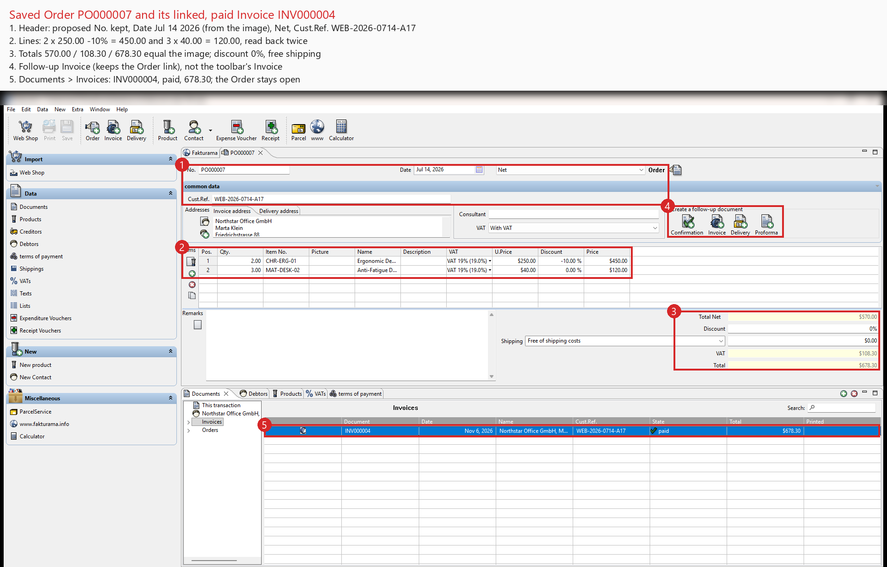

# Fakturama Image-to-Cash automation

One order image in; a saved, verified **Order** and its **linked, paid Invoice** out, in Fakturama 2.2.0 on Windows. A vision LLM reads the image and OCR cross-checks it. Fakturama is driven through **Microsoft UI Automation** (pywinauto) with no hardcoded coordinates. Every write is read back, every Save happens once, and anything ambiguous stops the run for manual review instead of guessing.

```
order image ──extract──▶ OrderSpec JSON (validated) ──run──▶ Fakturama: master data, Order, Invoice
            └─────────────────────────── automate = extract, then run ────────────────────────────┘
```

**Status:** the whole brief is implemented and has run end to end on the sample with one `automate` command, in a workspace set to EUR. The payment term, products and Debtor were created because they were missing. Order PO000009 was saved (lines 450,00 / 120,00 €, totals 570,00 / 108,30 / 678,30 €), and its Invoice INV000006 was saved as paid on 2026-07-18 with Value 678,30 €. Everything was verified in Data > Documents, then checked again with `check-invoice`. 753 offline tests. Differences from the brief and gaps are under [Deviations and limits](#deviations-and-limits).

## Setup

**Fakturama**
- Fakturama **2.2.0**, **English** UI, Windows, display scaling 100%. Start it and open the workspace yourself; the tool never launches it.
- File > Preferences > Documents: *immediately take over a clearly found item number* must be **off** (preflight checks it).
- **Set the currency yourself** (File > Preferences > General > *Currency locale*). Fakturama has one currency per workspace and the tool never changes it. The sample is in EUR, so choose a euro country such as *Germany* (see [Currency](#currency)).
- Back up the workspace folder before a run that creates records.

**Python**
- Python 3.12 and [uv](https://docs.astral.sh/uv/); `uv sync` installs the dependencies (pywinauto, google-genai, RapidOCR, pydantic, PyYAML).
- Copy `.env.example` to `.env` and set `GEMINI_API_KEY` (only needed for extraction; responses are cached in `.cache/`).

**During a run:** keep Fakturama maximized and in front, keep hands off mouse and keyboard, and close editors with unsaved changes. Turn off desktop notifications: one covering Fakturama makes the table reader wait.

## Run it

```
uv run python -m fakturama_agent automate samples/order_001.png --without-email
```

`automate` extracts the image to `out/<image name>/order.json` and then runs it. Fakturama is touched only if extraction passed every check; otherwise the command writes `review.md` and stops. The two stages also run separately, for example to inspect or correct the OrderSpec in between:

```
uv run python -m fakturama_agent extract samples/order_001.png -o out/order.json
uv run python -m fakturama_agent run out/order.json --without-email
```

`run` prints one line per step and writes `out/runs/<time>/`: `report.md`, `journal.jsonl`, before/after screenshots of every step, and a UIA dump when it stops. Exit codes: 0 done, 2 stopped for review, 1 usage or operational error.

| Flag (`automate`, `run`) | Effect |
|---|---|
| `--without-email` | Fakturama rejects the sample's `marta.klein@example.test`. Without the flag the run stops before saving the Debtor; with it the Debtor is saved without E-Mail and the report says so. |
| `--accept-currency` | Go on although the order's currency differs from the workspace's; amounts are then shown in the workspace currency. |
| `--allow-duplicate` | Create another Order and Invoice although one already carries the Cust.Ref. |
| `--checked` | You checked Fakturama after an earlier run stopped right after a Save. |

**Single steps** (each runs preflight first):

| Command | What it does |
|---|---|
| `preflight` | window, version, English UI, unsaved editors, preferences, currency format |
| `read-table documents\|invoices\|debtors\|products\|vats\|payments` | a Data view as a table (read-only) |
| `check-master SPEC` / `create-master SPEC` | payment term, VAT, products, Debtor: check only / create what is missing |
| `create-order SPEC [--no-save]` / `check-order SPEC` | build, save and verify the Order / verify only |
| `invoice-open SPEC` | the linked Invoice with payment set, left unsaved |
| `create-invoice SPEC [--no-save]` / `check-invoice SPEC` | save and verify the Invoice / verify only |
| `inspect`, `locate` | dump the UIA tree, resolve the locators (development) |

**Tests:** `uv run pytest` runs the offline suite (no network, no Fakturama); `-m live` calls Gemini, `-m uia` needs a running Fakturama.

## How it works

**Extraction** (`extract/`, `spec/`). Gemini Flash fills a fixed JSON schema, copying values verbatim. Code normalizes them (ISO dates, `Decimal` money, closed enums) and derives the rest (gross product price, VAT name, payment code, expected line nets). RapidOCR re-reads the image and must confirm every critical value character for character, and the arithmetic must hold (lines, net, VAT, gross). Any failure produces `review.md` instead of an OrderSpec.

**Finding controls** (`uia/`). Controls are located by name and structure from one registry, `uia/locators.yaml` (e.g. "the Edit after the label *ZIP - City*"), inside the window or editor the run bound by its handle. Zero or several matches is an error, never a guess. Clicks go to the centre of a UIA rectangle after a hit test confirms the target. Text is typed with real keys and read back after focus leaves. Amounts are parsed, and money fields typed, in the workspace's currency format, which preflight reads from Preferences.

**Tables** (NatTable exposes no rows to UIA). The grid's pixels decide whether it is empty and which rows are highlighted, and OCR checks the header. Rows are copied with Select All + Copy, and the clipboard is accepted only if Fakturama wrote it fresh and two copies agree. Copy is sent only when exactly the expected rows are highlighted, because Copy without a selection crashes Fakturama 2.2.0.

**The run** (`flow/`). Explicit steps, each ending ok, create, review or stop:
1. **Gates:** spec, journal, preflight, currency, Error.log baseline, duplicate guard on Cust.Ref.
2. **Master data**, created only when missing: payment term, VAT, products, Debtor (billing address with the Invoice role, delivery address with the Delivery role).
3. **Order:** header, then Debtor and products picked in the Order's own selectors by exact match, then lines, totals and addresses. Save once and check the Documents row.
4. **Invoice:** the Order's follow-up Invoice; copied fields confirmed; payment term set; paid with date and Value = Total. Save once, then check the Invoice row, that the Order is still open, and the reopened Invoice.

Every saved record is read back. A Save is never repeated: the journal records each attempt, and an unknown outcome blocks the next run until `--checked`. Reruns are idempotent because every step checks first; an Order without an Invoice is resumed with the Invoice only. A simulator (`FakeFakturama`) implements the same step interface, so the decision tree is tested offline.

More detail: [docs/DESIGN.md](docs/DESIGN.md), and the phase plans with everything observed live ([Phase 3](docs/PHASE3_PLAN.md), [Phase 4](docs/PHASE4_PLAN.md)).

## Evidence

**Video:** [a full `automate` run, image to paid Invoice](https://www.youtube.com/watch?v=I7JOPBT1x00) (YouTube).

[](https://www.youtube.com/watch?v=I7JOPBT1x00)

**Screenshots:** annotated from the runner's own evidence, with personal paths blurred (`tools/annotate_screenshots.py`):

1. [Product created](docs/screenshots/1-product-created.png): CHR-ERG-01, gross 297,50 € = 250.00 × 1.19, VAT 19%.
2. [Debtor created](docs/screenshots/2-debtor-created.png): Northstar Office GmbH / Marta Klein.
3. [Order and paid Invoice](docs/screenshots/3-order-and-invoice.png): PO000009 with both lines and totals; INV000006 paid, 678,30 €.



All three come from one clean `automate` run in a euro workspace, which finished on the first attempt. Earlier history: the first full run used a US-dollar workspace, so its EUR amounts showed `$`, which led to the currency check. Its clean test needed three runs, because a desktop notification twice covered part of a Data view; the reader now waits up to 10 s for such an overlay and keeps a screenshot of it. The first euro run stopped before saving a product because the price was typed with a dot, which led to typing money in the workspace's format.

## Deviations and limits

- **Order of operations.** The brief creates missing master data from inside the open New Order. `run` settles master data first, then builds the Order and selects everything through the Order's own selectors, which remain the final existence check. Every editor then sees fresh lists (the Debtor editor reads the payment list only once), and no Order sits half-built while other editors save.
- **E-mail.** Fakturama rejects the `.test` domain; see `--without-email`.
- <a id="currency"></a>**Currency is set by the user, not by the tool.** Fakturama 2.2.0 has one currency per workspace; a document cannot be "in EUR" on its own. The tool never changes the setting. It reads the currency format in preflight, parses every amount in it, and types money fields in it (`297,50` in Germany; NatTable cells and the VAT value always take a dot). `run` works out the workspace currency from the locale and its symbol and stops for review if it differs from the order's, unless `--accept-currency`. Full runs passed in both a US-dollar and a euro (Germany) workspace.
- **Tested environment.** English Fakturama 2.2.0, 100% scaling, maximized window, one sample image; full runs with the US and German currency formats. Preflight refuses other UI languages and currency formats it cannot pin down; a date display other than `MMM d, yyyy` stops the run.
- **Not exercised live:** saving an UNPAID Invoice (that branch ran unsaved), Credit Card and SEPA terms, VAT rates other than 19% (0% needs an exemption code and is refused), and more lines than the item grid shows without scrolling (the run stops).
- **Keyboard layout.** Ctrl shortcuts are sent as virtual keys and were verified with an Arabic layout active; full runs used the English layout.

## Written questions

**1. If you had 3 more hours, what would you do for this task?**

In this order:

1. **Event-driven intake.** In a real deployment, nobody would type a command per image; order images arrive on a queue (a mailbox, a watched upload folder, or a message queue such as SQS or Azure Service Bus). A small worker would consume it:
   - **One consumer.** Fakturama is a single desktop app, so messages are processed strictly one at a time, and the worker checks Fakturama is idle before taking the next.
   - **Ack only on a verified result.** A message is acknowledged only after `automate` ends in "done". A review outcome goes to a review queue with `review.md` or `report.md` attached, so a person can fix and requeue it.
   - **Safe redelivery.** The idempotency key is the image hash plus Cust.Ref. The existing duplicate guard, resume and journal already make a redelivered message harmless: it resumes or reports "already done", and a Save of unknown outcome is held for a person instead of retried.
   - **Status per message.** Each message's outcome and run folder are written back, for a dashboard or alerting.
2. **The brief's Order-first sequence** as an option of `run`: open the Order, try its selectors, create what is missing from there, and return to the same Order. The building blocks exist; what is missing is keeping the Order bound while other editors save, plus simulator tests for that path.
3. **More real inputs.** Varied images (other layouts, photos, unpaid, Credit Card and SEPA, two VAT rates, more lines) turned into golden tests, then run live, including a saved unpaid Invoice.
4. **A sturdier desktop session.** Detect notifications and focus thieves in preflight, scroll the item grid for long orders, and run in a dedicated Windows session or VM where nothing can cover Fakturama.

## Notes

Known Fakturama pitfalls were cross-checked once against a public attempt at this task; all were re-verified live, and the implementation is independent.
